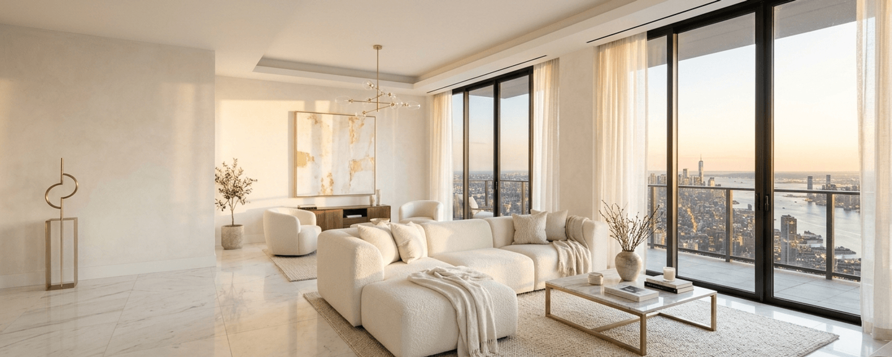
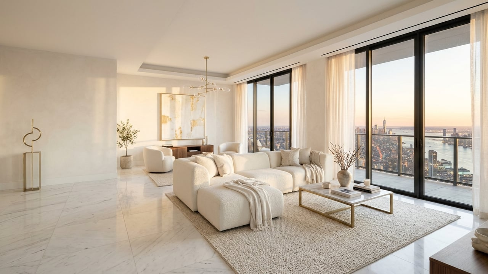
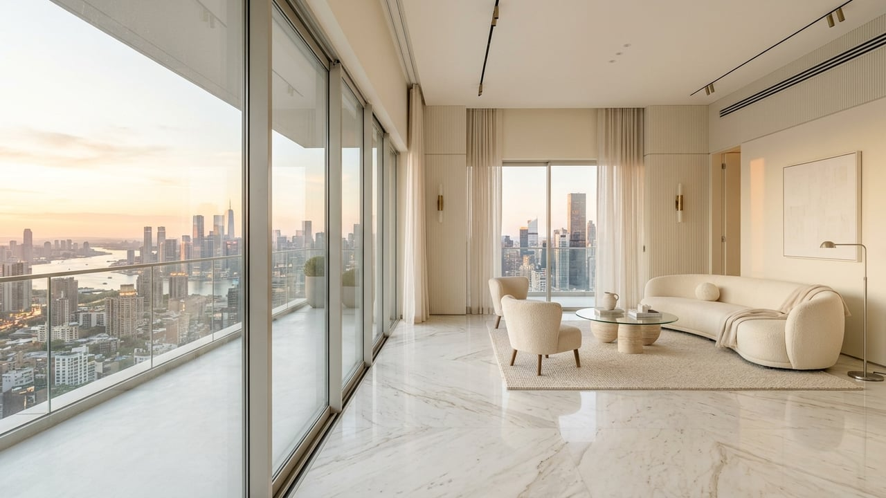

<p align="center"></p>

# THE SKYLINE PENTHOUSE

An immersive first-person 3D architectural walkthrough of an ultra-luxury penthouse (~280 m², ceiling 3.4m) in a major metropolitan city, running entirely in the browser like a high-end video game.

[**🌐 Explore Live Demo**](https://your-project.vercel.app)

---

## Overview

**The Skyline Penthouse** redefines architectural visualization on the web. Built with modern WebGL and physics, the player navigates an open-concept 280 m² luxury residence and a 105 m² private sky terrace in pure first-person perspective. The experience features real-time lighting transitions, interactive appliances, surface-aware procedural sound design, and an ivory travertine and bouclé aesthetic.

The architectural shell, lighting, and sound are synthesized procedurally in code, while focal luxury furniture, lighting, and decor feature real photorealistic 3D models from Poly Haven (CC0), optimized with `@gltf-transform/cli` with WebP textures and `meshopt` geometry compression. Zero external HDR skyboxes, zero image textures, zero hotlinking, and zero backend required.

---

## Gallery

<p align="center">
  
  &nbsp;
  
</p>

*Concept images generated with AI. Final experience runs live in the browser.*

---

## Features

- **Architectural Layout (~280 m² Interior + 105 m² Sky Terrace)**:
  - **Grand Living Gallery** (11m × 8m): Floor-to-ceiling panoramic glass, bouclé L-sectional sofa, marble coffee table, curved armchairs, 85" OLED TV, grand piano, and linear fireplace.
  - **Kitchen & Dining Pavilion** (6.5m × 8m): Waterfall Calacatta Gold marble island, flush induction cooktop, French-door refrigerator, backlit cabinetry, 8-seater travertine dining table, and wine display.
  - **Private Sky Terrace & Jacuzzi** (17.5m × 6m): Recessed jacuzzi with animated bubbling water, outdoor teak lounge, 1.2m frameless glass railing, and panoramic city vistas.
  - **Master Bedroom Suite** (8m × 6m): King bed with fluted bouclé headboard, sheer linen drapes, reading armchair, and illuminated vanity desk.
  - **Walk-in Dressing Wardrobe** (4m × 5m): Boutique open wardrobes, brass garment rails, backlit shoe shelves, and central jewelry island.
  - **Master Bath & Spa** (4m × 5m): Freestanding resin soaking tub, walk-in rain shower with steam mist, dual travertine vanities, and brass fixtures.
  - **Guest Bedroom Suite** (7m × 4.5m): Modernist double bed, working desk with laptop, nightstands, and private closet.
  - **Guest Powder Room** (3m × 3m): Monolithic travertine pedestal basin, brass wall-mounted tap, and backlit pill mirror.
  - **Grand Entrance Foyer** (6m × 4.5m): Private elevator vestibule, marble console, round brass mirror, and ribbon bronze sculpture.
  - **Gallery Hallway** (3m × 8m): Central connecting gallery with architectural arched portals.

- **Interactive Physics & Architecture**:
  - Reusable **Door System** with hinged swing doors and sliding terrace glass doors featuring dynamic Rapier kinematic colliders that update in real time.
  - **Interactive Windows & Curtains**: Openable sliding windows that initiate ambient wind breezes, fluttering sheer curtains and indoor plants.
  - **Posture Transitions**: Sit on sofas, bar stools, and terrace loungers; lie down on king and guest beds with smooth camera easing.
  - **Interactive Appliances**: Toggle the 85" OLED TV with generative visuals, ignite the glowing linear fireplace, turn on kitchen cooktop coils, open refrigerator doors, run bathroom faucets, and activate the Jacuzzi spa jets.
  - **Scene Lighting Panel**: Toggle room-by-room architectural downlights and lamps, or apply global presets from the pause menu or wall switches.

- **Dynamic Atmosphere & Skyline (Phase 6)**:
  - **Day / Sunset / Night Atmosphere**: Seamless real-time transitions for sun angle, color temperature, atmospheric fog, and automatic interior night illumination.
  - **Procedural City Skyline**: 220+ instanced skyscrapers with emissive window grids that illuminate at night, curved metropolitan river, synchronized flashing red aviation spires, drifting procedural cumulus clouds, and distant circling birds.
  - **Studio Lighting & Reflections**: Drei `Environment` powered by procedural `Lightformer` softboxes (zero external HDR) and real-time planar floor reflections via `MeshReflectorMaterial`.
  - **Cinematic Post-Processing**: Luminance-threshold Bloom, Eskil vignette framing, and ACES Filmic tone mapping via `@react-three/postprocessing`.

- **Procedural Web Audio API Synthesis Engine (Zero Audio Files)**:
  - Generative electric piano ambient jazz chords with evolving low-pass filter sweeps.
  - Surface-aware footstep audio (travertine stone click, hardwood oak thud, bouclé rug rustle).
  - Physical interaction sounds: door latches, sliding glass wheels, wind gusts, running water streams, fireplace crackles, and relaxed breathing harmonics.
  - Volume control and instant mute (`M` key).

- **Architectural Photo Studio Mode**:
  - Dedicated viewfinder mode (`P` key) with Rule-of-Thirds composition grid.
  - Adjustable focal length (FOV 45° to 95°).
  - One-click high-resolution PNG screenshot export.

- **Performance & Adaptive Quality**:
  - 4-Tier quality presets (**Low**, **Medium**, **High**, **Ultra**) scaling shadow resolution, pixel ratio (DPR), reflector passes, and post-processing.
  - Full mobile optimization with virtual touch joystick and lookpad.

---

## Controls

### Desktop Controls
| Key / Input | Action |
|---|---|
| **W, A, S, D** / **Arrows** | Walk / Move in 3D space |
| **Mouse Look** | Look around (Pointer Lock) |
| **E** / **Left Click** | Interact (Doors, Windows, Appliances, Lights, Sit, Lie Down) |
| **Shift** (Hold) | Sprint with dynamic FOV acceleration |
| **Spacebar** | Jump / Stand up from bed or chair |
| **C** | Toggle Crouch (lowers eye level to 1.0m) |
| **P** | Toggle Architectural Photo Mode |
| **M** | Toggle Audio Mute |
| **Esc** | Pause Walkthrough & open Settings / Teleport / Lighting Menu |

### Mobile Touch Controls
| Control | Action |
|---|---|
| **Left Screen Region** | Floating Virtual Analog Joystick for movement |
| **Right Screen Region** | Swipe / Drag to look around |
| **Action Button** (✨) | Interact / Open doors / Use furniture |
| **Jump Button** (↑) | Jump / Stand up |
| **Crouch Button** (↓) | Toggle Crouch |
| **Sprint Button** (🔥) | Sprint |
| **Pause Button** (⚙️) | Open Pause & Settings Menu |

---

## Tech Stack

- **Framework**: [Next.js 15](https://nextjs.org/) (App Router, Turbopack, React 19)
- **Language**: [TypeScript](https://www.typescriptlang.org/)
- **3D & Rendering**:
  - [Three.js](https://threejs.org/)
  - [@react-three/fiber](https://docs.pmnd.rs/react-three-fiber/)
  - [@react-three/drei](https://github.com/pmndrs/drei)
- **Physics**: [@react-three/rapier](https://github.com/pmndrs/react-three-rapier) (Kinematic colliders, raycasting)
- **Post-Processing**: [@react-three/postprocessing](https://github.com/pmndrs/react-postprocessing)
- **Audio Engine**: Custom procedural synthesizer built on native **Web Audio API**
- **State Management**: [Zustand](https://github.com/pmndrs/zustand)
- **UI & Motion**: [Framer Motion](https://www.framer.com/motion/), [Lucide React](https://lucide.dev/), [Tailwind CSS](https://tailwindcss.com/)

---

## Getting Started

### 1. Prerequisites
- **Node.js**: `v18.18+` or `v20+` / `v22+` / `v24+`
- **npm**: `v9+` or `v10+` / `v11+`

### 2. Installation
```bash
git clone https://github.com/satetapongsa/penthouse.git
cd penthouse
npm install
```

### 3. Development Server
Run the local Next.js development server:
```bash
npm run dev
```
Open [http://localhost:3000](http://localhost:3000) in your browser.

### 4. Production Build
Verify the production build locally:
```bash
npm run build
npm run start
```

---

## Deploy to Vercel

The project is pre-configured for zero-configuration deployment on **Vercel**:

### Option A: Connect via GitHub (Recommended)
1. Push your repository to GitHub:
   ```bash
   git push -u origin main
   ```
2. Open your [Vercel Dashboard](https://vercel.com/dashboard) and click **"Add New Project"**.
3. Import the `penthouse` repository.
4. Next.js will be detected automatically. Click **"Deploy"**.

### Option B: Deploy via Vercel CLI
```bash
npm i -g vercel
vercel --prod
```

---

## Project Structure

```
├── app/
│   ├── globals.css           # Global luxury theme tokens & Tailwind styles
│   ├── layout.tsx            # Root layout with fonts, OpenGraph & Twitter metadata
│   └── page.tsx              # Main entry page mounting client orchestrator
├── components/
│   ├── canvas/
│   │   ├── PenthouseCanvas.tsx       # WebGL R3F Canvas & physics world
│   │   └── PostProcessingEffects.tsx # Bloom, Vignette, tone mapping
│   ├── doors/
│   │   └── Door.tsx                  # Kinematic hinged & sliding doors
│   ├── environment/
│   │   ├── AtmosphericLighting.tsx   # Day/Sunset/Night sun & Drei Lightformers
│   │   └── CitySkyline.tsx           # Instanced skyscrapers, river, clouds, birds
│   ├── furniture/                    # 10 fully furnished room components
│   │   ├── foyer/FoyerFurniture.tsx
│   │   ├── living/LivingFurniture.tsx
│   │   ├── kitchen/KitchenDiningFurniture.tsx
│   │   ├── bedroom/MasterBedroomFurniture.tsx
│   │   ├── wardrobe/WardrobeFurniture.tsx
│   │   ├── bathroom/MasterBathroomFurniture.tsx
│   │   ├── guest/GuestBedroomFurniture.tsx
│   │   ├── powder/PowderRoomFurniture.tsx
│   │   └── terrace/TerraceFurniture.tsx
│   ├── interaction/
│   │   └── InteractionManager.tsx    # Center-camera raycaster
│   ├── intro/
│   │   └── IntroOverlay.tsx          # Cinematic title & loading screen
│   ├── mobile/
│   │   └── MobileControls.tsx        # Virtual analog joystick & lookpad
│   ├── navigation/
│   │   ├── MiniMap.tsx               # Tactical SVG floor plan with vision cone
│   │   ├── RoomBanner.tsx            # Animated room entry label
│   │   └── TeleportMenu.tsx          # Directory fast-travel overlay
│   ├── player/
│   │   └── Player.tsx                # Rapier capsule physics, crouch & head bob
│   ├── room/
│   │   └── PenthouseShell.tsx        # Physical walls, travertine floors, windows
│   └── ui/
│       ├── HUD.tsx                   # Crosshair, pause menu, time toggle, quality
│       └── PhotoModeOverlay.tsx      # Composition grid & PNG screenshot exporter
├── docs/
│   ├── banner.png                    # 1600x640 luxury banner for GitHub README
│   ├── banner-raw.png                # High-res raw banner
│   └── gallery/                      # Gallery images for README
├── hooks/
│   ├── useDeviceDetect.ts            # Touch device detection
│   └── useKeyboardControls.ts        # Keyboard shortcut bindings
├── lib/
│   ├── audio.ts                      # Procedural Web Audio API sound engine
│   ├── config.ts                     # Single source of truth for architectural dimensions
│   └── materials.ts                  # Procedural canvas textures
├── public/
│   └── og-banner.png                 # 1200x630 social sharing card
├── store/
│   └── useGameStore.ts               # Zustand store for world, player & UI state
└── package.json
```

---

## 3D Assets

Key luxury furniture, seating, lighting fixtures, botanical plants, and decorative tabletop props are real photorealistic 3D assets sourced from **[Poly Haven](https://polyhaven.com/)** under **Creative Commons 0 (CC0) / Public Domain**.

- **Zero Hotlinking**: All models are downloaded once and committed locally to `/public/models/`.
- **Attribution & Catalog**: Complete list of model sources, Poly Haven links, and CC0 licenses is maintained in [`public/models/CREDITS.md`](public/models/CREDITS.md).
- **Optimization Pipeline**: Models are processed through an automated `@gltf-transform` pipeline:
  - Deduplication, scene pruning, and vertex welding.
  - Geometry simplification: < 8,000 triangles for furniture, < 3,000 for tabletop props.
  - Texture optimization: resized to 256–1024px and encoded in modern WebP.
  - Geometry compression using `meshopt` (`KHR_mesh_quantization`, `EXT_meshopt_compression`).
  - Total bundle size across all 18 models is **2.77 MB** (budget < 15 MB).

### Re-running the Pipeline

To fetch and re-optimize the models from Poly Haven at any time:

```bash
# 1. Query the Poly Haven API and download 1k glTF assets
npm run models:fetch
# or: node scripts/fetch-models.mjs

# 2. Run the optimization pipeline and generate comparison report
npm run models:optimize
# or: node scripts/optimize-models.mjs
```

---

## License

Private & Proprietary — The Skyline Penthouse. Built for high-performance interactive architectural visualization.
